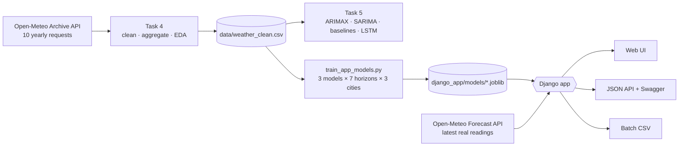

<div align="center">

# ☁️ Atmos — Weather Time-Series Forecasting

**From 10 years of raw weather data to a deployed machine-learning web app.**
Time-series EDA · ARIMA/SARIMA forecasting · 7-day ML forecasts · Django web app & JSON API

**[🌐 Live demo](https://YOUR-DOMAIN-HERE)** · **[📘 API docs](https://YOUR-DOMAIN-HERE/api/)** · **[🧪 Swagger UI](https://YOUR-DOMAIN-HERE/api/swagger/)**

</div>

---

## 📑 Table of contents
1. [Overview](#-overview)
2. [Features](#-features)
3. [Screenshots](#-screenshots)
4. [Architecture](#-architecture)
5. [Data](#-data)
6. [Methodology](#-methodology)
7. [Results](#-results)
8. [Quick start](#-quick-start)
9. [REST API](#-rest-api)
10. [Testing](#-testing)
11. [Deployment](#-deployment)
12. [Configuration](#-configuration)
13. [Project structure](#-project-structure)
14. [Limitations & future work](#-limitations--future-work)
15. [Author & credits](#-author--credits)

---

## 🔭 Overview

This project covers the full life-cycle of a forecasting product, split into three stages:

| Stage | What was built | Where |
|---|---|---|
| **Task 4 — Data & EDA** | Pulled **10 years of hourly weather** (2016-10-16 → 2026-10-15) from the Open-Meteo archive API, cleaned it, aggregated to daily values and analysed trend, seasonality, decomposition, ACF/PACF and stationarity. | `Task4_Weather_API_EDA.ipynb` |
| **Task 5 — Forecasting** | Preprocessing for time series, ADF/KPSS tests, **ARIMA + yearly Fourier terms**, a true **SARIMA** on monthly means, walk-forward validation, baselines and an optional RNN/LSTM. | `Task5_Time_Series_Forecasting.ipynb` |
| **Task 6 — Deployment** | **Atmos**: a Django web app that serves 3 ML models × 7 forecast horizons for **Cairo, Alexandria and Aswan**, with a JSON API, batch predictions and a climate-insights dashboard. | `django_app/` |

> The notebooks answer *"what do the data say and what can be forecast?"*; the web app answers *"how can anyone use it?"*.

---

## ✨ Features

**Forecasting**
- **7-day outlook** (tomorrow + 6 more days) with a **95 % prediction range** and the **seasonal normal** for comparison.
- **Three models** to choose from — Ridge Regression, Gradient Boosting, Random Forest — or **Best (auto)**.
- **"Why this prediction?"** chart: shows how much each input moves the forecast compared with average conditions.
- Warning when an input is **outside the range the model was trained on**.

**Real data**
- **"Use latest real data"** button — fills the form with yesterday's real readings from Open-Meteo and plots the last days on the chart.
- **Multi-city**: Cairo, Alexandria, Aswan (add more in one line of `config.py`).

**Productivity tools**
- **Batch predictions** — upload a CSV (up to 1000 rows) and download the results.
- **Prediction history** — last 8 predictions with CSV export (kept in a signed cookie, no database).
- **Insights dashboard** — 10-year climate profile: monthly percentiles, yearly means, last 365 days vs. normal, rainfall, month × year heat-map and KPIs.

**For developers**
- **REST/JSON API** with OpenAPI spec, **Swagger UI**, an **in-browser playground** (cURL / Python / JavaScript snippets) and per-IP **rate limiting**.
- Input validation shared by the web form, API and CSV upload (one source of truth).

**UX**
- Dark / light theme, **English / Arabic (RTL)**, responsive layout, city-specific background photos with a cross-fade.

**Engineering**
- **38 automated tests**, GitHub Actions CI, Dockerfile, Vercel & Render configs, `manage.py check_model` command that proves the app reproduces the training predictions.

---

## 🖼️ Screenshots

| Home — 7-day forecast | Insights dashboard |
|---|---|
|  |  |

| API playground | Batch predictions |
|---|---|
|  |  |

---

## 🏗️ Architecture



**Design decisions**
- **Pure-Python core, thin Django layer.** Training (`trainer.py`), prediction (`ml.py`), validation, CSV batch handling, Open-Meteo client, insights and the OpenAPI spec have **no Django imports**, so they are unit-testable without a web stack.
- **Models are loaded once** when the server starts and reused across requests; identical requests are served from an in-memory cache.
- **Stateless.** No database — history lives in a signed session cookie, so the app runs unchanged on serverless platforms.

---

## 🗄️ Data

| Item | Value |
|---|---|
| Source | [Open-Meteo Historical Weather API](https://open-meteo.com/) (free, no API key) |
| Period | 2016-10-16 → 2026-10-15 (10 years) |
| Raw granularity | Hourly, UTC (no DST gaps/duplicates) — **87,648 records** for Cairo |
| Variables | temperature (°C), relative humidity (%), precipitation (mm), wind speed (km/h), surface pressure (hPa), cloud cover (%) |
| Modelling granularity | **Daily** — 3,652 days (mean of temperature/humidity/wind/pressure/cloud, **sum** of precipitation, plus daily min/max) |
| Cities | Cairo (30.04 N, 31.24 E) · Alexandria (31.20 N, 29.92 E) · Aswan (24.09 N, 32.90 E) |

**Cleaning pipeline** (Task 4): parse datetimes → drop duplicate timestamps → reindex to a strict hourly frequency → flag physically impossible values → fill gaps (≤ 6 h by time interpolation, longer gaps by seasonal-naive fill) → aggregate to daily → flag outliers with a **rolling 31-day z-score** (|z| > 3.5) and **winsorize** instead of deleting. Result for Cairo: **0 duplicates, 0 missing timestamps, 0 impossible values**, 1 temperature and 2 wind-speed outliers capped.

> Raw API responses are cached on disk (one file per year), so downloads are reproducible and resumable after a rate-limit.

---

## 🧠 Methodology

### Task 4 — Exploratory analysis (Cairo)
| Finding | Value |
|---|---|
| Daily mean temperature | 23.4 °C (std 6.5, range 8.9 → 36.3 °C) |
| Yearly seasonality strength | **0.90** (additive decomposition, period 365) |
| Long-term trend (after removing seasonality) | **+1.62 °C per decade** (autocorrelation makes the p-value optimistic) |
| Stationarity | ADF p = 0.0023 · KPSS p ≥ 0.10 → stationary once the deterministic yearly cycle is handled |
| Temperature ↔ humidity correlation | −0.57 |

### Task 5 — Forecasting
- **Chronological split**: last **90 days = test**; never shuffled.
- **Stationarity**: ADF + KPSS on the raw, differenced, seasonally-differenced and Fourier-deseasonalised series → decides `d`.
- **ARIMAX + yearly Fourier terms (K = 3)** — a seasonal period of 365 is impractical for SARIMA, so the yearly cycle is modelled deterministically with Fourier regressors and ARIMA handles the short-term dependence. Order chosen from ACF/PACF and compared with `auto_arima` (if installed).
- **True SARIMA(1,0,1)(1,1,1,12)** on monthly means (24-month hold-out) to demonstrate seasonal differencing.
- **Diagnostics**: residual plots, Q-Q/histogram, **Ljung-Box**.
- **Walk-forward validation**: 5 rolling 30-day windows with refits, plus **error by forecast horizon**.
- **Baselines**: persistence, seasonal-naive (same day last year), climatology (day-of-year average).
- **Bonus**: Simple-RNN and LSTM (scaler fitted on train only, inverse-transformed before metrics).

### Task 6 — The ML models behind the app
The web form supplies *today's* mean temperature, humidity, wind, pressure and the date, so the app uses a **direct multi-horizon** strategy: one model per horizon `h = 1…7` predicts the mean temperature at `t + h` from those inputs plus day-of-year (sine/cosine encoded).

- Three model families × 7 horizons × 3 cities = **63 models**.
- Evaluated on the same **chronological hold-out** (no training row whose target falls inside the test window → **no label leakage**), then **re-fitted on all data** for production.
- The 95 % range is `prediction ± 1.96 × (hold-out residual std for that horizon)`.
- **Explanation chart**: each input is replaced by its training average, one at a time, and the change in the forecast is reported.

---

## 📊 Results

Hold-out **MAE (°C)** on the last 90 days — lower is better.

**Cairo**
| Model | +1 d | +3 d | +7 d |
|---|---|---|---|
| Ridge Regression | 0.69 | 0.99 | 0.98 |
| Gradient Boosting | 0.70 | 0.98 | 1.05 |
| **Random Forest** | **0.64** | **0.94** | 1.02 |
| Persistence (today = tomorrow) | 0.69 | 1.16 | 1.50 |
| Climatology (seasonal average) | 1.02 | 0.99 | 0.99 |

**Alexandria**
| Model | +1 d | +3 d | +7 d |
|---|---|---|---|
| **Ridge Regression** | **0.48** | 0.75 | 0.84 |
| Gradient Boosting | 0.52 | **0.73** | **0.80** |
| Random Forest | 0.50 | 0.75 | 0.86 |
| Persistence | 0.48 | 0.87 | 1.05 |
| Climatology | 0.84 | 0.86 | 0.86 |

**Honest takeaways**
- For tomorrow, the models are **~30–40 % better than the seasonal average** and equal or slightly better than "tomorrow = today" (daily temperature is very persistent, so persistence is a strong baseline).
- The advantage over persistence **grows with the horizon** (e.g. Cairo +7 d: 0.98 vs 1.50).
- Beyond **~4 days** the models are roughly as accurate as the **seasonal normal** — which is why every forecast card also shows the normal. Long-range skill would need numerical weather-model inputs, not just today's observations.
- Aswan's numbers are shown on the app's **About** page after training.

> Exact figures for every model/horizon/city are in the **About** page of the app and in `outputs/` (notebook results).

---

## 🚀 Quick start

### Prerequisites
Python 3.12+ and Git. Internet access is needed for the first data download.

### 1. Install
```bash
git clone https://github.com/nouramaherelamin/Weather-Time-Series.git
cd Weather-Time-Series
python -m pip install -r requirements.txt
```
`pmdarima` (auto_arima) and `tensorflow` (LSTM bonus) are optional — install them separately if wanted; the code skips them gracefully.

### 2. Run the pipeline *(in this order)*
| Step | Command | Output |
|---|---|---|
| Task 4 | open `Task4_Weather_API_EDA.ipynb` *(or `python task4_data_eda.py`)* | `data/weather_clean.csv`, plots & summary in `outputs/` |
| Task 5 | open `Task5_Time_Series_Forecasting.ipynb` *(or `python task5_forecasting.py --skip-lstm`)* | diagnostics, forecasts, model comparison in `outputs/` |
| App models | `python train_app_models.py` | `django_app/models/<city>.joblib` |

`train_app_models.py` options: `--cities aswan` (only some cities), `--fast` (smaller models for a smoke test), `--refresh` (re-download). Downloads are cached; if the API rate-limits you, simply run the command again. It also **pins** `pandas / numpy / scikit-learn / joblib` in `django_app/requirements.txt` to the versions used for training.

### 3. Run the web app
```bash
cd django_app
python manage.py check_model     # verifies the app reproduces the training predictions
python manage.py test            # 38 tests, no internet and no trained model needed
python manage.py runserver       # http://127.0.0.1:8000
```

### Docker
```bash
docker compose up --build        # http://localhost:8000  (train the models first)
```

---

## 🔌 REST API

Base URL: `https://YOUR-DOMAIN-HERE` · No API key · **60 requests/minute per IP** · Interactive docs at **`/api/`** and **`/api/swagger/`** · Spec at **`/api/openapi.json`**.

| Method | Endpoint | Description |
|---|---|---|
| `GET` · `POST` | `/api/predict/` | 7-day forecast from today's readings |
| `GET` | `/api/latest/?city=cairo` | Latest **real** daily readings (Open-Meteo) + 30-day history |
| `POST` | `/api/batch/` | CSV upload (`file`), JSON or `?format=csv` response |
| `GET` | `/api/models/` | Cities, models and their hold-out accuracy |
| `GET` | `/api/health/` | Health check |

**Request**
```bash
curl -G "https://YOUR-DOMAIN-HERE/api/predict/" \
  --data-urlencode "temperature=24" --data-urlencode "humidity=50" \
  --data-urlencode "wind_speed=12" --data-urlencode "pressure=1012" \
  --data-urlencode "date=2026-04-15" --data-urlencode "city=cairo" --data-urlencode "model=best"
```

**Parameters**

| Name | Meaning | Allowed |
|---|---|---|
| `temperature` | today's mean temperature (°C) | −10 … 55 |
| `humidity` | mean relative humidity (%) | 0 … 100 |
| `wind_speed` | mean wind speed (km/h) | 0 … 150 |
| `pressure` | mean surface pressure (hPa) | 900 … 1100 |
| `date` | date of the readings | `YYYY-MM-DD` |
| `city` *(optional)* | `cairo`, `alexandria`, `aswan` | default `cairo` |
| `model` *(optional)* | `best`, `ridge`, `gbr`, `rf` | default `best` |

**Response (shortened)**
```json
{
  "city": "Cairo, Egypt",
  "model": "rf",
  "prediction": 24.5,
  "low": 22.8,
  "high": 26.2,
  "forecast": [
    { "day": 1, "date": "2026-04-16", "prediction": 24.5, "low": 22.8, "high": 26.2, "normal": 22.13 }
  ],
  "explain": [{ "feature": "season", "label": "Time of year", "effect": 0.41 }],
  "outside_training_range": [],
  "mae_day1": 0.64
}
```
Errors: `400` validation (field-level messages) · `429` rate limit (`Retry-After` header) · `502` live-data provider unavailable · `503` models not trained.

**Batch CSV format**
```csv
date,temperature,humidity,wind_speed,pressure
2026-04-14,23.5,48,11.2,1011.8
```
Optional columns: `city`, `model`. Maximum 1000 rows / 1 MB.

---

## 🧪 Testing

```bash
cd django_app
python manage.py test -v 2
```
- **`test_logic.py`** (15 tests, pure Python): validation, training/prediction shape, *app prediction == training prediction*, outside-range flag, cache isolation, batch parsing with bad rows, Open-Meteo parsing and failure handling, insights, OpenAPI spec.
- **`test_views.py`** (23 tests): pages, inline form errors, history cap/export/clear, city-specific backgrounds, API success and validation errors, live-data endpoint with a mocked provider (cache + 502), batch JSON/CSV, rate limiting (429), graceful behaviour when no model is trained.

Tests build tiny synthetic models, so they need **neither the internet nor the real trained files** — they run on every push via **GitHub Actions** (`.github/workflows/ci.yml`).

---

## ☁️ Deployment

### Vercel (zero-config Django)
1. Commit `django_app/models/*.joblib` and make sure `django_app/requirements.txt` has pinned versions (`python train_app_models.py` does this).
2. Vercel → **Add New → Project** → import the repo → **Root Directory: `django_app`**.
3. Add environment variables: `DJANGO_DEBUG=0` and `DJANGO_SECRET_KEY=<random>`  
   (`python -c "import secrets; print(secrets.token_urlsafe(50))"`).
4. Deploy and check `/api/health/`. For a custom domain add it under **Settings → Domains**, then set `DJANGO_ALLOWED_HOSTS` and `DJANGO_CSRF_ORIGINS` (see below) and redeploy.

### Render
Use the included `render.yaml` (**New + → Blueprint**).

### Any WSGI host / Docker
```bash
pip install -r django_app/requirements.txt
cd django_app && python manage.py collectstatic --noinput
gunicorn weather_site.wsgi:application
```

---

## ⚙️ Configuration

| Variable | Default | Purpose |
|---|---|---|
| `DJANGO_DEBUG` | `1` | set `0` in production |
| `DJANGO_SECRET_KEY` | dev key | **required** when `DJANGO_DEBUG=0` |
| `DJANGO_ALLOWED_HOSTS` | `localhost,127.0.0.1` | comma-separated hosts (your domain) |
| `DJANGO_CSRF_ORIGINS` | – | e.g. `https://example.com,https://www.example.com` |
| `DJANGO_HTTPS` | `1` | secure cookies in production (`0` for plain-http Docker) |
| `API_RATE_LIMIT` | `60` | API requests per minute per IP |
| `WEATHER_MODELS_DIR` | `django_app/models` | folder containing the `*.joblib` bundles |

Vercel and Render hostnames are detected automatically. To add a city, append one entry (`slug`, `name`, `lat`, `lon`) to `CITIES` in `config.py`, optionally add `django_app/forecast/static/forecast/<slug>.jpg` as its background, and re-run `train_app_models.py`.

---

## 📁 Project structure

```
Weather-Time-Series/
├── config.py                         # cities, date range, paths (single source of settings)
├── Task4_Weather_API_EDA.ipynb       # API download · cleaning · EDA
├── Task5_Time_Series_Forecasting.ipynb  # stationarity · ARIMAX/SARIMA · walk-forward · LSTM
├── task4_data_eda.py                 # same as the notebooks, as scripts
├── task5_forecasting.py
├── train_app_models.py               # builds the per-city model bundles for the app
├── data/                             # raw API response, weather_clean.csv, per-city CSVs
├── outputs/                          # plots, summaries, metrics
├── Dockerfile · docker-compose.yml · render.yaml
├── .github/workflows/ci.yml          # tests on every push
└── django_app/
    ├── manage.py · vercel.json · requirements.txt
    ├── weather_site/                 # settings, urls, wsgi
    ├── models/                       # <city>.joblib (3 models × 7 horizons each)
    └── forecast/
        ├── trainer.py  ml.py  validation.py        # ┐
        ├── openmeteo.py  batchio.py  insights.py   # ├ pure Python, no Django imports
        ├── openapi.py                              # ┘
        ├── forms.py  views.py  urls.py  ratelimit.py  context.py   # Django glue
        ├── templates/forecast/       # base, index, insights, batch, about, api, swagger
        ├── static/forecast/          # style.css, app.js, api.js, city photos
        ├── management/commands/check_model.py
        └── test_logic.py  test_views.py
```

---

## ⚠️ Limitations & future work

- Forecasts use **today's daily means only**; accuracy beyond ~4 days converges to the seasonal normal. Feeding numerical weather-prediction outputs or several recent days (lags) would extend the useful horizon.
- Models are trained **per city** on one data source; there is no ensemble across providers.
- Intervals are based on hold-out residual spread (assumes similar error behaviour in the future); conformal prediction would give stronger guarantees.
- "Latest real data" comes from Open-Meteo's analysis data, which can differ slightly from the archive used for training.
- On serverless platforms the rate-limit counter and cache are per instance (approximate).
- Ideas: more cities and a map picker, hourly forecasts, model monitoring/retraining job, user accounts to persist history.

---

## 👩‍💻 Author & credits

**Noura Maher Elamin** — Data analysis · dashboards · machine-learning web apps

[](https://www.linkedin.com/in/nouramaherelamin/)
[](https://github.com/nouramaherelamin)

Built as part of the **NiCST Machine Learning training series** (Tasks 4 – 6).

**Data & assets**
- Weather data by [**Open-Meteo.com**](https://open-meteo.com/) — licensed under [CC BY 4.0](https://creativecommons.org/licenses/by/4.0/).
- Browser-tab icon by [Icons8](https://icons8.com).
- Libraries: Django, scikit-learn, statsmodels, pandas, NumPy, Chart.js, Bootstrap, Swagger UI.

© 2026 Noura Maher Elamin. All rights reserved.
